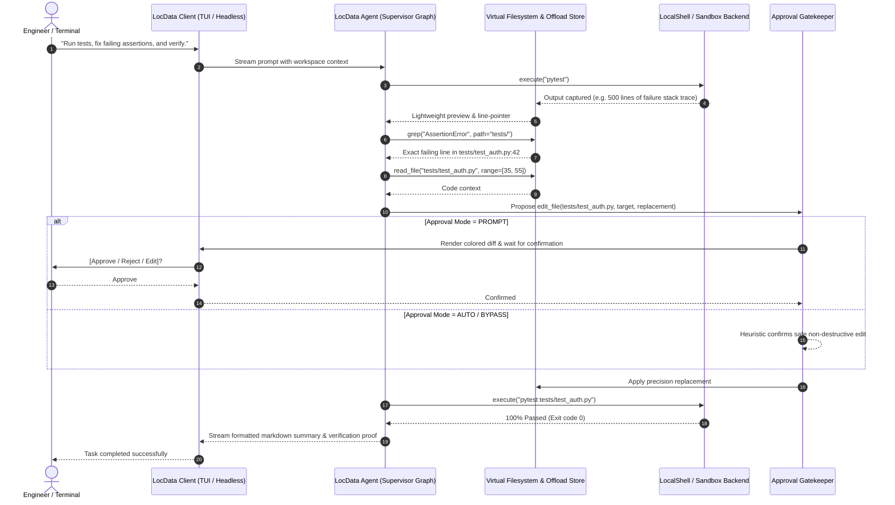
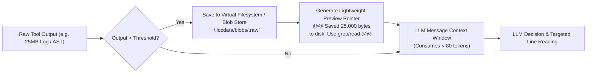

# 🧠⚡ LocData Code (`loccode`)

### *The Autonomous AI Coding & General Problem-Solving Agent Harness*

<div align="center">

---

## 📑 Table of Contents

- [Architectural Philosophy](#-architectural-philosophy)
- [System Architecture](#-system-architecture)
  - [1. The Multi-Layer Engine Stack](#1-the-multi-layer-engine-stack)
  - [2. Autonomous Execution &amp; Verification Loop](#2-autonomous-execution--verification-loop)
  - [3. Context Safety &amp; Zero-Blowout Blob Offloading](#3-context-safety--zero-blowout-blob-offloading)
- [Key Features](#-key-features)
- [Repository &amp; Package Anatomy](#-repository--package-anatomy)
- [Installation &amp; Global CLI Setup](#-installation--global-cli-setup)
- [Configuration Scopes](#-configuration-scopes)
- [Usage &amp; Execution Modes](#-usage--execution-modes)
  - [1. Interactive Full-Screen TUI (`loccode`)](#1-interactive-full-screen-tui-loccode)
  - [2. Inline Terminal REPL (`loccode --repl`)](#2-inline-terminal-repl-loccode---repl)
  - [3. Headless CI/CD Mode (`loccode -x`)](#3-headless-cicd-mode-loccode--x)
- [Slash Commands Catalog](#-slash-commands-catalog)
- [Multi-Model Provider Support](#-multi-model-provider-support)
- [Automated Testing &amp; Verification](#-automated-testing--verification)
- [Building &amp; Publishing](#-building--publishing)
- [License](#-license)

---

## 🏛️ Architectural Philosophy

Standard LLM agents fail on complex engineering tasks because of four foundational bottlenecks:

1. **Context Pollution:** Raw tool outputs (e.g. 10,000-line test logs or AST dumps) flood the prompt, destroying attention ("lost-in-the-middle") and escalating token costs.
2. **Quadratic Checkpointing ($O(N^2)$):** Traditional agent graphs re-serialize accumulating message histories on every turn, causing latency degradation.
3. **Hallucinatory File Rewrites:** Asking models to rewrite 1,000-line files to change 3 lines causes syntax loss and accidental regressions.
4. **Execution Insecurity:** Giving unvetted shell execution directly on host developer environments poses severe blast-radius hazards.

**LocData Code solves these problems through an opinionated harness:**

- **Virtual Filesystem Suite:** Equipped with `ls`, `glob`, `grep`, `read_file`, and surgical exact-match `edit_file`.
- **Blob Offloading (`_blob_offload.py`):** Automatically intercepts large tool responses, stores them on virtual storage, and injects lightweight preview pointers into the context window.
- **Linear Checkpointing (`DeltaChannel`):** Checkpoints state in linear $O(N)$ time with periodic snapshotting.
- **Three-Tier Human Approval Gate:** Inspects proposed edits and dangerous shell commands before execution.
- **Pluggable Unified Backends:** Supports local workspace execution or isolated cloud sandboxes (Docker, Modal, Daytona).

---

## 🏗️ System Architecture

### 1. The Multi-Layer Engine Stack

LocData Code decouples user interaction, agent orchestration, and graph state execution into four distinct layers:

```mermaid
flowchart TD
    subgraph UI_Layer["1. Presentation & Client Layer (Textual & Rich)"]
        TUI["Interactive Textual TUI (`loccode`)"]
        REPL["Inline Terminal REPL (`loccode --repl`)"]
        HEADLESS["Headless CI/CD Runner (`loccode -x`)"]
    end

    subgraph Harness_Layer["2. LocData Code Harness (`locdata_code`)"]
        CONFIG["Config Resolver (`~/.locdata/config.toml`)"]
        AUTH["Auth Store (`~/.locdata/auth.json`)"]
        GATE["Approval Mode Engine (`prompt` / `auto` / `bypass`)"]
        DIFF["Diff & Patch Visualizer"]
        MCP["MCP Gateway (fastmcp / `.mcp.json`)"]
        SKILLS["Skills Engine (`SKILL.md` Loader)"]
    end

    subgraph Deep_Agents_Layer["3. Deep Agents Scaffold (`create_deep_agent`)"]
        BLOB["_blob_offload.py (Payload Offloader)"]
        SUMM["Summarization & History Compactor"]
        TASK["Subagent Task Delegator (`task`)"]
        VFS["Filesystem Suite (`ls`, `glob`, `grep`, `read`, `write`, `edit`)"]
        EXEC["Shell Execution Gateway (`execute`)"]
        MEM["Persistent Memory Manager (`LOCDATA.md`)"]
    end

    subgraph Runtime_Layer["4. Durable Graph Runtime (LangGraph)"]
        GRAPH["CompiledStateGraph"]
        DELTA["DeltaChannel Reducer (O(N) Scaling)"]
        CHECK["SQLite Checkpointer (`~/.locdata/sessions.db`)"]
        INTERRUPT["Human-in-the-Loop Interrupts"]
    end

    UI_Layer --> Harness_Layer
    Harness_Layer --> Deep_Agents_Layer
    Deep_Agents_Layer --> Runtime_Layer
```



---

### 2. Autonomous Execution & Verification Loop

Every request in LocData Code follows a closed-loop verification lifecycle:



---

### 3. Context Safety & Zero-Blowout Blob Offloading

When an agent executes commands that produce large logs or when reading massive files, standard agent architectures blow up the LLM's context window. LocData Code uses **Blob Offloading**:



---

## ✨ Key Features

| Capability                       | Technical Mechanism                             | Benefit                                                                              |
| -------------------------------- | ----------------------------------------------- | ------------------------------------------------------------------------------------ |
| **Terminal Integration**   | Global binary `loccode` in `$PATH`          | Launch with a single keystroke from any directory.                                   |
| **Full-Screen TUI**        | [Textual](https://textual.textualize.io/) + Rich | Live streaming, syntax-highlighted code blocks, collapsible tool bubbles.            |
| **Surgical Code Editing**  | `edit_file` exact-match replacement           | Eliminates hallucinated code wipes and preserves existing codebases.                 |
| **Multi-Provider Models**  | Dynamic Model Resolver                          | Seamlessly connects to SenseNova, Anthropic Claude, OpenAI, Gemini, or local Ollama. |
| **CI/CD Automation**       | Headless mode (`-x` / `--json`)             | Direct integration into GitHub Actions, pre-commit hooks, and deployment scripts.    |
| **Three Safety Modes**     | `prompt`, `auto`, `bypass`                | Granular control over file writes and bash executions.                               |
| **Model Context Protocol** | `MCPManager` (`.mcp.json`)                  | Connects external tools and databases dynamically.                                   |
| **Modular Skills**         | `SkillManager` (`SKILL.md`)                 | On-demand discovery of specialized workflows without system prompt stuffing.         |
| **Multi-Turn Persistence** | LangGraph SQLite Checkpointer                   | Preserves threads across terminal restarts via `--resume <session_id>`.            |

---

## 📂 Repository & Package Anatomy

```
/Users/sachinmishra/Desktop/Langchain_Deep_Agents/
├── locdata_code/                    # Core Python Package
│   ├── __init__.py                  # Version declaration & lazy entrypoints
│   ├── __main__.py                  # Enables `python -m locdata_code`
│   ├── main.py                      # CLI Argument Parser (-x, --json, -m, -a, --repl)
│   ├── agent.py                     # Deep Agent Graph Compiler & System Prompt
│   ├── config.py                    # Multi-Tier TOML Configuration Engine
│   ├── paths.py                     # Path resolver (~/.locdata, ./.locdata, LOCDATA.md)
│   ├── approval_mode.py             # Human-in-the-Loop Approval & Safety Heuristics
│   ├── auth_store.py                # Credential Manager (~/.locdata/auth.json)
│   ├── diff_utils.py                # Unified Diff Generator & Syntax Styler
│   ├── command_registry.py          # Unified Slash Commands Catalog
│   ├── headless.py                  # Headless CI/CD Runner with JSON Event Stream
│   ├── mcp/
│   │   ├── __init__.py
│   │   └── manager.py               # MCP Server Configuration Discovery
│   ├── skills/
│   │   ├── __init__.py
│   │   └── loader.py                # SKILL.md Frontmatter & Instruction Parser
│   ├── tools/
│   │   ├── __init__.py
│   │   └── web_search.py            # DuckDuckGo Search Integration
│   └── tui/
│       ├── __init__.py
│       ├── app.py                   # Textual Full-Screen App & Fallback REPL
│       ├── widgets.py               # ChatStream, MessageBubble, ToolBubble, StatusBar
│       └── theme.py                 # LocData Color Palette, Banners & Glyphs
├── tests/                           # Comprehensive Automated Test Suite
│   ├── test_agent_assembly.py       # Validates LangGraph state graph compilation
│   ├── test_approval_mode.py        # Validates prompt/auto/bypass security logic
│   ├── test_config.py               # Validates TOML loading, hierarchy & defaults
│   └── test_diff_and_commands.py    # Validates diff generation & slash commands
├── docs/                            # Architectural Guides & Reports
│   └── DEEP_AGENTS_BLUEPRINT_REPORT.md
├── pyproject.toml                   # Hatchling build config & CLI console scripts
└── README.md                        # Documentation & User Guide
```

---

## 🚀 Installation & Global CLI Setup

### 1. Editable Local Install (Recommended for Development)

From the repository root:

```bash
uv pip install -e .
# Or using pip:
pip install -e .
```

### 2. Global Installation as a Standalone Tool

To make `loccode` executable from any terminal session without needing to activate a virtual environment:

```bash
uv tool install --editable --force .
```

Verify global availability:

```bash
which loccode
# Output: /Users/sachinmishra/.local/bin/loccode

loccode --version
# Output: LocData Code v0.1.0
```

---

## ⚙️ Configuration Scopes

LocData Code resolves configurations hierarchically:

1. **CLI Flags** (`-m`, `-a`, `--json`)
2. **Project-Level Config** (`./.locdata/config.toml`)
3. **Global User Config** (`~/.locdata/config.toml`)
4. **Environment Variables** (`LOCDATA_MODEL`, `LOCDATA_APPROVAL`)
5. **System Defaults**

### Sample `~/.locdata/config.toml`:

```toml
approval_mode = "prompt"
enable_web_search = true

[model]
provider = "sensenova"
model = "sensenova-6.8-flash-lite"
temperature = 0.2
```

---

## 💻 Usage & Execution Modes

### 1. Interactive Full-Screen TUI (`loccode`)

Launches the full interactive terminal application:

```bash
loccode
```

### 2. Inline Terminal REPL (`loccode --repl`)

Launches a lightweight in-line REPL without alternate screen buffers:

```bash
loccode --repl
```

### 3. Headless CI/CD Mode (`loccode -x`)

Executes a task autonomously and exits with return code `0` on success, `1` on error:

```bash
# Refactor and verify test suite
loccode -x "Run pytest tests/ and fix any failing test assertions"

# Read, inspect, and summarize dependencies
loccode -x "Read pyproject.toml and list all core dependencies"

# Emit structured JSON events for automation pipelines
loccode -x "Inspect git status" --json
```

---

## ⌨️ Slash Commands Catalog

Type `/` at the interactive prompt to execute commands:

| Command       | Aliases           | Description                                                     |
| ------------- | ----------------- | --------------------------------------------------------------- |
| `/help`     | `/?`            | Display all available commands and argument hints               |
| `/clear`    | `/reset`        | Clear the current chat view and initialize a fresh thread       |
| `/approval` |                   | Switch execution safety mode (`prompt`, `auto`, `bypass`) |
| `/diff`     |                   | Inspect unstaged git changes across the project                 |
| `/model`    |                   | View or switch active LLM provider                              |
| `/auth`     | `/connect`      | Check API credentials status                                    |
| `/skills`   |                   | List active domain skills loaded from `SKILL.md`              |
| `/mcp`      |                   | List active Model Context Protocol (MCP) servers                |
| `/exit`     | `/quit`, `/q` | Exit LocData Code                                               |

---

## 🤖 Multi-Model Provider Support

LocData Code automatically detects your configured API keys:

```bash
# 1. SenseNova (Default)
export SENSENOVA_API_KEY="your_sensenova_key"
loccode -m sensenova-6.8-flash-lite

# 2. Anthropic Claude
export ANTHROPIC_API_KEY="your_anthropic_key"
loccode -m anthropic:claude-3-7-sonnet-20250219

# 3. OpenAI
export OPENAI_API_KEY="your_openai_key"
loccode -m openai:gpt-4o

# 4. Google Gemini
export GOOGLE_API_KEY="your_gemini_key"
loccode -m gemini-2.0-flash

# 5. Local Ollama
export OLLAMA_BASE_URL="http://localhost:11434/v1"
loccode -m llama3.1
```

Credentials can also be stored permanently in `~/.locdata/auth.json`.

---

## 🧪 Automated Testing & Verification

Run the test suite:

```bash
uv run pytest -v
```

Test coverage:

- ✅ `test_agent_assembly.py`: CompiledStateGraph validation and tool bindings
- ✅ `test_approval_mode.py`: Auto-safety heuristic and command categorization
- ✅ `test_config.py`: TOML serialization, path hierarchy, and environment merging
- ✅ `test_diff_and_commands.py`: Unified diff generation and slash command matching

---

## 📦 Building & Publishing

Build production wheels and source distributions:

```bash
uv run python -m build
```

Artifacts are generated in `dist/`:

- `locdata_code-0.1.0-py3-none-any.whl`
- `locdata_code-0.1.0.tar.gz`

Publish to PyPI:

```bash
twine upload dist/*
```

---

## 📄 License

Distributed under the **MIT License**. Built with pride by the **LocData AI Team**.
