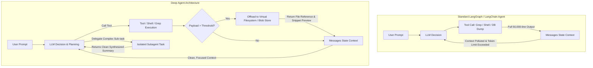
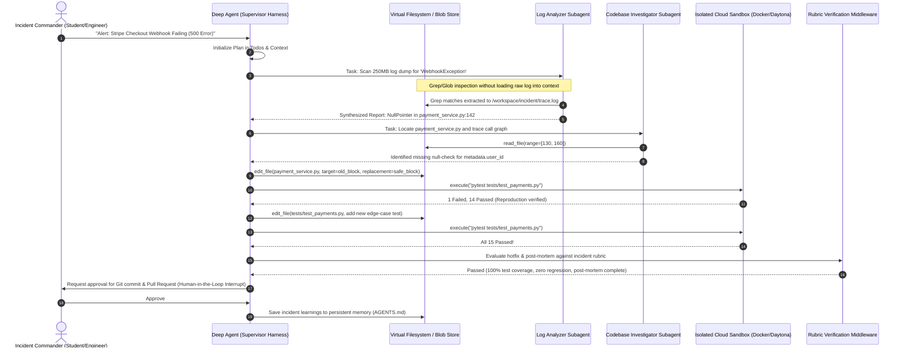

# Deep Agents Architecture & Industry Blueprint
**A Comprehensive Guide for Advanced LangGraph/LangChain Engineers & Educators**

---

## Executive Summary

As an engineer already well-versed in **LangChain** and **LangGraph**, you understand how to assemble agents using graph states, nodes, conditional edges, tools, and checkpointing. However, when transitioning from toy agent demos to enterprise-grade, long-horizon tasks (such as autonomous software engineering, deep financial research, multi-hour incident diagnosis, or sprawling codebase migrations), standard agent architectures hit severe technical ceilings:

1. **Context Window Pollution & Cost Explosions:** Raw tool outputs (e.g., thousands of lines of grep outputs, large JSON files, full AST dumps) flood the prompt context, leading to attention degradation ("lost in the middle"), high latency, and massive token costs.
2. **State Serialization Bloat:** Standard LangGraph checkpointers save entire message histories at every state transition, leading to $O(N^2)$ storage and checkpoint serialization overhead over extended trajectories.
3. **Context Drift in Subagent Chains:** Spawning sub-tasks in a monolithic graph contaminates the supervisor’s scratchpad with intermediate trial-and-error reasoning, degrading multi-step planning.
4. **Execution Insecurity:** Giving an agent raw shell access on developer or server environments poses severe security and blast-radius risks.
5. **Lack of Standard Scaffolding:** Developers spend weeks repeatedly building custom file managers, diff appliers, context-summarization reducers, human-approval gates, and prompt-caching hooks.

**Deep Agents** is LangChain’s answer to these challenges. It is not an alternative runtime to LangGraph; rather, it is an **opinionated, batteries-included agent harness built directly on top of LangChain and LangGraph**. It packages foundational architectural patterns—planning, virtual filesystem abstractions, context offloading, subagent isolation, long-term memory, and sandboxed code execution—into an extensible, production-ready framework.

---

## 1. Why Deep Agents is Required (The Paradigm Shift)

### The Three Layers of Agent Architecture

To understand why Deep Agents exists, one must visualize the three distinct layers defined by LangChain:

```
┌────────────────────────────────────────────────────────────────────────┐
│                              DEEP AGENTS                               │
│  The Opinionated Harness: Planning, Virtual Filesystem, Context        │
│  Offloading, Subagents, Long-term Memory, Skills, Sandboxed Execution  │
├────────────────────────────────────────────────────────────────────────┤
│                           LANGCHAIN CORE                               │
│  Agent Abstraction: Model + Tools + Middleware -> ReAct Loop           │
├────────────────────────────────────────────────────────────────────────┤
│                              LANGGRAPH                                 │
│  Durable Runtime: State Graph, Nodes, Edges, Delta Checkpointers,       │
│  Streaming Events, Interrupts, Human-in-the-Loop Resumption            │
└────────────────────────────────────────────────────────────────────────┘
```

| Layer | Responsibility | What it does NOT handle |
|---|---|---|
| **LangGraph** | Execution runtime (State graph, cyclic graphs, persistence, interrupts, streaming). | Does not know what tools an agent needs, how to manage files, or how to avoid context bloat. |
| **LangChain Core (`create_agent`)** | Basic ReAct loop abstraction: feeds prompt + tools to LLM, invokes tool calls, appends results. | Does not provide filesystem abstractions, planning rubrics, automatic context compaction, or subagent sandboxing. |
| **Deep Agents (`create_deep_agent`)** | Complete harness: pre-wired middleware stack, virtual filesystem, blob offloading, subagent spawning (`task`), persistent memory (`StoreBackend`), and sandboxed execution (`execute`). | Is not a separate execution engine—it delegates graph compilation to LangGraph. |

### The Core Architectural Gaps Solved by Deep Agents



#### 1. Context Offloading & Blob Management (`_blob_offload.py`)
In raw LangGraph, when an agent runs a tool that returns a 5MB payload (such as querying an API or reading a log file), the raw text is written into the `ToolMessage` and stored in the graph state. Every subsequent turn pays for those tokens, quickly exceeding the LLM's context window and degrading performance.
* **Deep Agents Solution:** The built-in `_blob_offload.py` middleware intercepts large tool responses. It persists the raw payload into a virtual filesystem or blob storage and replaces the message content with a lightweight reference pointer and preview. The agent can then use targeted inspection tools (`read_file`, `grep`) only on the specific lines it needs.

#### 2. Linear vs. Quadratic State Checkpointing (`DeltaChannel`)
Standard LangGraph graphs that use an append-style reducer on `messages` can suffer from $O(N^2)$ state growth. Every checkpoint re-serializes the entire accumulating message history.
* **Deep Agents Solution:** Deep Agents introduces `DeepAgentState` with a custom `DeltaChannel(_messages_delta_reducer, snapshot_frequency=50)`. It serializes only the message deltas per step, creating snapshot checkpoints periodically. This reduces checkpoint storage and serialization time from $O(N^2)$ to $O(N)$, which is essential for tasks spanning 100+ turns.

#### 3. True Subagent Context Isolation (`SubAgentMiddleware`)
When standard agents attempt to break down tasks by calling other tools, the intermediate reasoning, tool retries, and errors clutter the primary conversation history.
* **Deep Agents Solution:** Deep Agents includes a first-class `task` tool backed by `SubAgentMiddleware`. The supervisor spawns subagents that run in their own isolated graph loops with separate message histories. The subagent does the heavy lifting, diagnoses errors, and returns only a clean, finalized summary to the supervisor.

#### 4. Unified Filesystem Protocol & Pluggable Sandboxes
Raw agents either require dangerous local OS file operations or lack file manipulation tools altogether.
* **Deep Agents Solution:** Deep Agents establishes `BackendProtocol`, decoupling file operations from the host OS:
  - `StateBackend`: Thread-scoped virtual in-memory filesystem (ideal for ephemeral scratchpads).
  - `FilesystemBackend`: Mounts directly to a designated local directory with path validation.
  - `SandboxBackend`: Connects to isolated micro-VMs or cloud containers (Modal, Daytona, Runloop, LangSmith Sandboxes).
  - `CompositeBackend`: Maps directory prefixes to different backends (e.g., `/workspace` maps to disk, `/sandbox` to a remote container, and `/mem` to a key-value store).

#### 5. Declarative Skills & Progressive Disclosure (`SkillsMiddleware`)
Instead of stuffing 20 different prompt templates or specialized instructions into the system prompt, Deep Agents supports **Skills** based on open standards (folders containing `SKILL.md`). The agent discovers skills dynamically and reads specific instructions into its context only when the task requires them.

---

## 2. Deep Agents Core Capabilities & Internal Feature Breakdown

Deep Agents provides a comprehensive set of built-in components:

```
                       ┌──────────────────────────────────────────────┐
                       │             create_deep_agent()              │
                       └──────────────────────┬───────────────────────┘
                                              │
    ┌─────────────────────────┬───────────────┴─────────────┬─────────────────────────┐
    ▼                         ▼                             ▼                         ▼
┌──────────────────┐  ┌────────────────────┐  ┌───────────────────────┐  ┌─────────────────────┐
│ Filesystem Suite │  │ Planning & Memory  │  │ Execution & Sandboxes │  │  Middleware Stack   │
├──────────────────┤  ├────────────────────┤  ├───────────────────────┤  ├─────────────────────┤
│ • ls             │  │ • Todo Planning    │  │ • execute (Shell)     │  │ • Summarization     │
│ • read_file      │  │ • StoreBackend     │  │ • Modal / Daytona     │  │ • Blob Offload      │
│ • write_file     │  │ • MemoryMiddleware │  │ • Runloop / LangSmith │  │ • Prompt Caching    │
│ • edit_file      │  │ • SkillsEngine     │  │ • FilesystemPermission│  │ • Model Refusal     │
│ • glob / grep    │  │ • Rubric Evaluator │  │ • Human Approval Gate │  │ • Subagent Manager  │
└──────────────────┘  └────────────────────┘  └───────────────────────┘  └─────────────────────┘
```

### 1. Built-in Tool Surface
When initializing an agent via `create_deep_agent()`, the following tools are pre-configured:
* **Inspection & Discovery:**
  - `ls`: Lists files and directories with optional recursive traversal.
  - `glob`: High-speed glob pattern matching (`wcmatch`) across deep folder structures.
  - `grep`: Regex and string searching with context lines, hit counts, and line numbers.
* **Modification:**
  - `read_file`: Reads full or ranged segments of files (avoiding full reads of large files).
  - `write_file`: Atomic file creation and writing.
  - `edit_file`: Exact character-sequence targeted replacement (minimizing hallucinations compared to full-file rewriting).
* **Execution:**
  - `execute`: Executes bash commands inside the configured backend. If run against a non-sandbox backend, safety guardrails prevent destructive execution unless explicitly permitted.
* **Coordination:**
  - `task`: Dispatches isolated sub-tasks to general-purpose or specialized subagents.

### 2. The Middleware Pipeline Architecture
Deep Agents organizes functionality into a strictly sequenced middleware stack:
1. **Scaffolding Middleware (Immutable Core):**
   - `FilesystemMiddleware`: Exposes filesystem tools and enforces granular path policies.
   - `SubAgentMiddleware`: Intercepts calls to the `task` tool, compiles sub-graphs, and executes subagent loops.
   - `_blob_offload.py`: Catches oversized tool responses and offloads them to storage.
   - `create_summarization_middleware`: Monitors token accumulation and compacts older conversation history when context limits approach.
2. **Caller Middleware (User Injected):**
   - Domain-specific logic, logging, enterprise authentication tokens, custom metric collectors.
3. **Profile & Tail Middleware:**
   - `SkillsMiddleware`: Exposes registered domain skills without bloating initial system prompts.
   - `MemoryMiddleware`: Connects to LangGraph's long-term `BaseStore` to retrieve cross-session memories.
   - `HumanInTheLoopMiddleware`: Halts execution and emits LangGraph `interrupt` signals when actions exceed permission levels.
   - `_prompt_caching.py`: Injects provider-specific prompt-caching breakpoints (optimized for Anthropic, OpenAI, and Gemini).
   - `ModelRefusalMiddleware`: Gracefully handles model refusals and fallback routing.

### 3. Execution Backends & Security Governance
Deep Agents decouples the agent's logic from where its code executes:
* **Granular Permissions (`FilesystemPermission`):** Define regex-based path access rules (e.g., `read-only` on `/etc` and `/system`, `ask-user` on `/workspace/production.env`, `auto-allow` on `/workspace/scratch`).
* **Human-in-the-Loop Resumption:** When a sensitive file edit or shell execution occurs, Deep Agents interrupts execution. The application can prompt a human operator and resume the run via LangGraph’s standard `Command(resume=...)` pattern.

---

## 3. Deconstructing the Repository: `libs/code` & Ecosystem Implementations

An analysis of the [`langchain-ai/deepagents`](https://github.com/langchain-ai/deepagents) repository reveals how LangChain builds on top of this harness.

### Deep Dive into `libs/code` (`deepagents-code` / `dcode`)

The directory `libs/code` contains **`deepagents-code`** (packaged as the `dcode` CLI tool). It is a terminal coding agent (similar to Claude Code or Cursor) built directly on the Deep Agents SDK.

```
┌─────────────────────────────────────────────────────────────┐
│                    TERMINAL CLIENT (TUI)                    │
│  • Built with Python Textual framework                      │
│  • Streaming event renderer                                 │
│  • User approval prompts & 46+ Slash Commands (/context,    │
│    /cost, /agents, /clear, /editor, /auth, etc.)            │
└──────────────────────────────┬──────────────────────────────┘
                               │ Streaming Protocol
                               ▼
┌─────────────────────────────────────────────────────────────┐
│                        AGENT SERVER                         │
│  • Runs create_deep_agent graph                             │
│  • Connects Model, Filesystem Tools, Memory, Skills         │
│  • Connects to Remote Sandboxes (Modal, Daytona, LangSmith) │
│  • Supports Headless Mode (-x) for CI/CD pipelines          │
└─────────────────────────────────────────────────────────────┘
```

**Key Architectural Takeaways from `libs/code`:**
1. **Client/Server Decoupling:** The UI is completely isolated from agent execution. The TUI client handles terminal rendering and human approval inputs, while the agent server runs the LangGraph engine.
2. **Headless Execution (`-x` mode):** The exact same agent that runs interactively in the terminal can be executed headlessly inside GitHub Actions or CI/CD pipelines to autonomously fix pull requests or run test suites.
3. **Session Resumability:** Because state is rooted in LangGraph checkpointers, terminal sessions can be suspended, closed, and resumed seamlessly without losing context or memory.

### Survey of Real-World Implementations in the Repository (`examples/`)

The repository showcases diverse enterprise agent patterns built with Deep Agents:

| Example Pattern | Implementation Highlights | Real-World Value |
|---|---|---|
| **Open SWE** | Async coding agent integrated with Slack, Linear, and GitHub. Operates in isolated cloud sandboxes to reproduce bugs, write unit tests, fix code, and submit PRs. | Automates level-1/level-2 software engineering bug tickets without human intervention. |
| **Deep Research Agent** | Multi-step research coordinator using Tavily API, recursive search strategies, parallel subagent delegation, and reflection loops. | Produces high-depth market analysis and technical research reports with cited sources. |
| **Nemotron Research Agent** | Combines NVIDIA Nemotron models with GPU-accelerated code execution via NVIDIA RAPIDS. | High-performance data science, large-scale dataframe manipulation, and accelerated analytics. |
| **Rubric Middleware (`rubric_middleware/`)** | Implements an automated "Grader-Model" loop. The agent produces output, a critic model evaluates it against strict rubrics, and the agent iterates until all criteria pass. | Enforces strict compliance, regulatory rules, and high-precision formatting in enterprise workflows. |
| **Ralph Mode (`ralph_mode/`)** | An autonomous looping agent that wipes its message history on every iteration, using only the virtual filesystem for persistent state. | Solves "infinite context" tasks where an agent must run for hundreds of cycles without degrading attention. |
| **Text-to-SQL Agent (`text-to-sql-agent/`)** | Natural language to SQL engine with schema inspection, query planning, dialect-specific skills, and automated query execution validation. | Self-healing database reporting that catches SQL syntax and runtime errors and refines queries automatically. |
| **Deployable Content Strategist (`deploy-content-writer/`, `deploy-gtm-agent/`)** | Brand content and go-to-market strategist featuring per-user long-term memory (`AGENTS.md`) and persistent brand voice settings across sessions. | Maintains coherent enterprise marketing tone and brand guidelines across different teams and threads. |

---

## 4. The Burning Industry Problem: A Flagship Demonstration for Students

### The Industry Challenge: "Autonomous Production Incident Response & Verified Hotfix Agent"

When teaching advanced students who already understand basic LangChain and LangGraph graphs, toy problems (like calculator agents or simple Q&A bots) fail to demonstrate the value of Deep Agents. 

The industry faces a major challenge in **Autonomous Production Incident Response**:
* An unhandled exception or performance degradation triggers a P0/P1 alert in production.
* Engineers must sift through hundreds of megabytes of raw application logs, inspect distributed traces, explore sprawling multi-repo codebases, isolate the root cause, write a reproduction test case, author a hotfix, verify that no regressions occur, and prepare a post-mortem report.

### Why Vanilla LangChain / LangGraph Struggles with this Problem

```
Standard Agent Attempt:
1. User asks agent to inspect error in 500MB production log file.
2. Agent calls standard "read_log" tool -> 50MB of text is dumped into state.
3. CRASH: Context window limit exceeded, or token billing spikes by $80 in one turn.
4. Agent attempts to fix code -> hallucinated full-file rewrite breaks unrelated functions.
5. Agent attempts to run tests -> accidentally runs destructive script directly on the host machine.
```

### How Deep Agents Solves This Elegantly

Deep Agents addresses this challenge through its built-in architectural features:



### Detailed Breakdown of Deep Agents Features in this Demonstration

#### 1. Zero Context Explosion via Blob Offloading & Virtual Filesystem
* The 250MB log file is placed in the agent's backend storage.
* Instead of reading the entire file into messages, the agent uses `grep` with regex patterns (`ERROR.*payment_service`) to pull only matching lines with context buffers.
* If a tool output exceeds size thresholds, Deep Agents' `_blob_offload.py` stores the output on the virtual filesystem and returns a file pointer, preserving the agent's context budget.

#### 2. Subagent Specialization via the `task` Tool
* The primary Deep Agent acts as the **Incident Commander**. It builds a step-by-step todo list.
* It spawns a **Log Analysis Subagent** with read-only tools to extract the error signature.
* It spawns a **Code Search Subagent** to trace dependencies and find the offending function.
* The subagents operate in isolated contexts. Intermediate tool trials and search misses never pollute the Incident Commander’s context.

#### 3. Surgical Code Editing (`edit_file`)
* Standard LLMs often hallucinate or drop code when rewriting 1,000-line files.
* Deep Agents' `edit_file` tool performs an exact string replacement on a specific code block, ensuring surrounding business logic remains untouched.

#### 4. Sandboxed Code Execution (`SandboxBackendProtocol`)
* The agent executes `pytest tests/test_payments.py` in an isolated container backend (e.g., Docker, Modal, or Daytona) via the `execute` tool.
* Host infrastructure is protected from unintended side effects.

#### 5. Quality Assurance via `RubricMiddleware`
* The incident resolution must pass a strict rubric:
  - Did the agent create a reproduction unit test that reproduces the bug?
  - Do all existing regression tests pass?
  - Does the solution include an incident post-mortem markdown document with root-cause analysis?
* If any rubric criterion fails, the grader loops the agent back to address the missing requirement.

#### 6. Safe Production Gatekeeping via `HumanInTheLoopMiddleware`
* Before pushing code to GitHub or running deployment scripts, the agent triggers an interrupt.
* The student/engineer inspects the diff, reviews the post-mortem, and approves the action via the UI or terminal.

#### 7. Cross-Incident Learning via `MemoryMiddleware`
* The agent writes the root-cause summary and prevention rules to `/memory/incident_patterns.md`.
* In future runs across different threads, the agent checks this long-term memory to recognize similar regressions immediately.

---

## 5. Educational Blueprint & Student Curriculum

To help students master Deep Agents, this four-stage progression builds practical competency:

```
┌─────────────────────────────────────────────────────────────────────────┐
│ STAGE 1: The Bottlenecks of Raw LangGraph                               │
│ • Build a standard ReAct agent in LangGraph                             │
│ • Intentionally overload it with large files (observe context blowout)   │
│ • Measure quadratic checkpoint serialization time ($O(N^2)$)            │
├─────────────────────────────────────────────────────────────────────────┤
│ STAGE 2: Deep Agents Scaffolding & Virtual Filesystems                  │
│ • Implement `create_deep_agent()` with `StateBackend` & `Filesystem`    │
│ • Inspect `_blob_offload.py` and `DeltaChannel` linear scaling ($O(N)$) │
│ • Compare full-file rewrites vs precision `edit_file`                   │
├─────────────────────────────────────────────────────────────────────────┤
│ STAGE 3: Subagent Isolation & Skill Modularity                          │
│ • Configure supervisor-worker patterns using the built-in `task` tool   │
│ • Create modular `SKILL.md` packages for domain-specific tasks          │
│ • Compare monolithic context bloat vs isolated subagent execution      │
├─────────────────────────────────────────────────────────────────────────┤
│ STAGE 4: Enterprise Sandboxing, Rubrics & Deployment                    │
│ • Connect `SandboxBackend` (Docker/Daytona) for secure code execution   │
│ • Implement `RubricMiddleware` for automated evaluation & self-healing   │
│ • Wire `HumanInTheLoopMiddleware` approval gates for deployment safety  │
└─────────────────────────────────────────────────────────────────────────┘
```

---

## Conclusion & Key Takeaways

1. **Deep Agents is an Opinionated Harness, Not a New Engine:** It runs on LangGraph. If LangGraph is the high-performance engine block, Deep Agents is the fully assembled vehicle—complete with transmission, dashboard, and safety systems.
2. **Context Management is the Core Differentiator:** Long-horizon agency is fundamentally a context management problem. Through `_blob_offload.py`, `summarization`, `DeltaChannel`, and isolated subagent scopes, Deep Agents prevents context bloat and runaway token costs.
3. **From Fragile Scripts to Production Systems:** By unifying filesystem operations, sandboxed bash execution, declarative skills, and human-in-the-loop approvals, Deep Agents provides the foundational architecture needed for real-world enterprise deployments.
