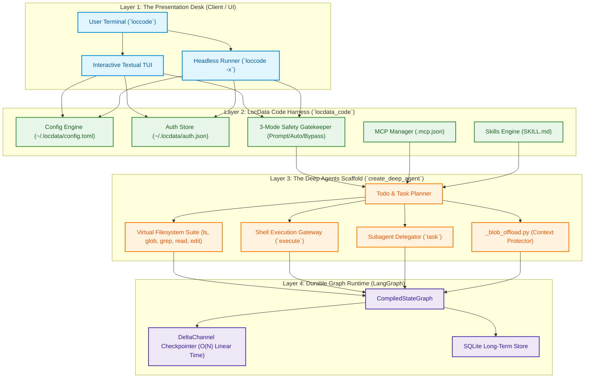
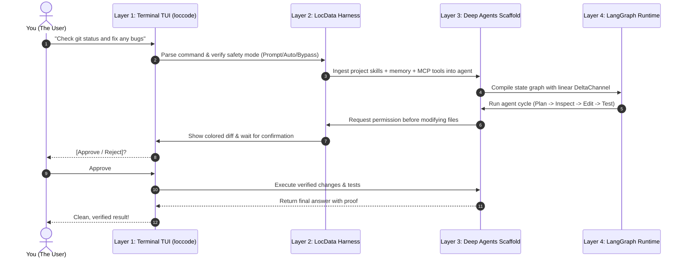

# 📘 Chapter 1: The Master Architecture Overview
### *How LocData Code, Deep Agents, and LangGraph Work Together*

> 💡 **The Simple Analogy (Explain It Like I'm 12):**  
> Imagine you want to build a real city.  
> - **LangGraph** is the **concrete ground and steel roads**—it makes sure you don't fall and that traffic flows safely.  
> - **LangChain** is the **standard toolbox** (hammers, screwdrivers, measuring tapes).  
> - **Deep Agents** is the **construction factory**—it gives you ready-to-use blueprints, cranes, storage warehouses, and walkie-talkies.  
> - **LocData Code (`loccode`)** is the **Chief Architect's Office**—it is the terminal desk where you sit, give orders, view blueprints, and command the entire workforce!

---

## 🏗️ The 4-Layer Architecture Diagram

Every time you type a command into `loccode`, it flows smoothly through four interconnected layers:

---

## 🔍 What Each Layer Does (Step-by-Step)

---

## ⚖️ Why Raw LangGraph Was Not Enough

If you only use raw LangGraph, you have to build **everything from scratch**:

```mermaid
flowchart LR
    subgraph RawLangGraph["Without Deep Agents (Raw LangGraph)"]
        direction TB
        R1["❌ 10,000-line tool outputs crash the context window"]
        R2["❌ Checkpoints grow quadratically O(N²) and slow down"]
        R3["❌ Agents hallucinate when rewriting 500-line files"]
        R4["❌ Running shell commands on host is dangerous"]
        R5["❌ Subagents dump 50 messy steps into main conversation"]
    end

    subgraph WithDeepAgents["With LocData Code + Deep Agents"]
        direction TB
        W1["✅ Blob offloader saves large outputs to disk with preview"]
        W2["✅ DeltaChannel keeps checkpoints linear O(N) and fast"]
        W3["✅ `edit_file` only replaces exact targeted lines safely"]
        W4["✅ LocalShellBackend with directory limits & approval gates"]
        W5["✅ Subagents run in isolated rooms and return only final answers"]
    end

    RawLangGraph -->|Upgraded to| WithDeepAgents
```

