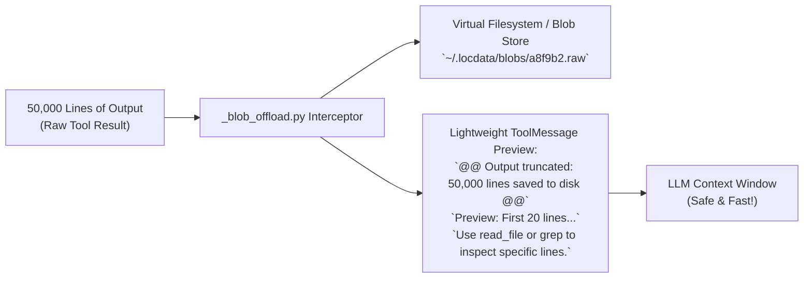
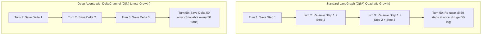

# ⚙️ Chapter 2: The Deep Agents Core Engine

### *The Magic Behind Context Offloading, Delta Checkpointing, and Auto-Compaction*

> 💡 **The Simple Analogy (Explain It Like I'm 12):**Imagine you have a school backpack (the LLM's brain / context window).If your teacher gives you a giant 1,000-page encyclopedia, you cannot fit it in your backpack—it will rip!
>
> - **A basic agent** tries to force the whole encyclopedia into the backpack and crashes.
> - **Deep Agents** leaves the encyclopedia in the school library locker (the Virtual Filesystem), puts a tiny sticky note with the locker number in your backpack, and tells you: *"Only open page 42 when you need it!"*

---

## 🔄 ReAct Loop vs. The Deep Agent Harness Loop

A standard ReAct agent is fragile. Deep Agents upgrades it into a self-protecting, multi-turn system:

```mermaid
flowchart TD
    subgraph Traditional_Loop["Standard ReAct Agent Loop"]
        T_Prompt["User Prompt"] --> T_LLM["LLM Decision"]
        T_LLM --> T_Tool["Run Tool (e.g. Read 50MB Log)"]
        T_Tool -->|Full 50MB dumped into state| T_State["Message History State"]
        T_State -->|Context Overflow! Crash or High Cost| T_LLM
    end

    subgraph Deep_Agent_Loop["Deep Agents Harness Loop"]
        D_Prompt["User Prompt"] --> D_LLM["LLM Decision & Planning"]
        D_LLM --> D_Tool["Run Tool (Shell / File / Search)"]
        D_Tool --> D_Check{"Output > Threshold?\n(e.g. > 10,000 bytes)"}
      
        D_Check -->|YES| D_Offload["_blob_offload.py:\nSave to Disk / Blob Store"]
        D_Offload --> D_Pointer["Generate Lightweight Pointer & Snippet\n(Takes < 60 tokens)"]
        D_Pointer --> D_State["Message State"]
      
        D_Check -->|NO| D_State
        D_State --> D_Summarizer{"Context > 80% Full?"}
        D_Summarizer -->|YES| D_Compact["summarization.py:\nCompress older history"]
        D_Summarizer -->|NO| D_Delta["DeltaChannel Checkpointer:\nSave O(N) delta state"]
        D_Compact --> D_Delta
        D_Delta --> D_LLM
    end
```

---

## 📦 1. How Context Offloading Works (`_blob_offload.py`)

When an agent executes `pytest` or inspects a 250MB log file, standard tools would crash the conversation. Look at how Deep Agents handles it:

---

## 📈 2. Linear vs. Quadratic Checkpointing (`DeltaChannel`)

In standard LangGraph, saving state in a long thread becomes slower and slower. Deep Agents solves this with `DeltaChannel`:

| Metric                     | Standard LangGraph                     | Deep Agents (`DeltaChannel`)                |
| -------------------------- | -------------------------------------- | --------------------------------------------- |
| **Storage per step** | Entire cumulative conversation         | Only the incremental change (delta)           |
| **Complexity**       | $O(N^2)$ (Quadratic blowup)          | $O(N)$ (Strictly linear)                    |
| **Database Latency** | Degrades significantly after 30+ turns | Constant and lightning-fast across 100+ turns |
