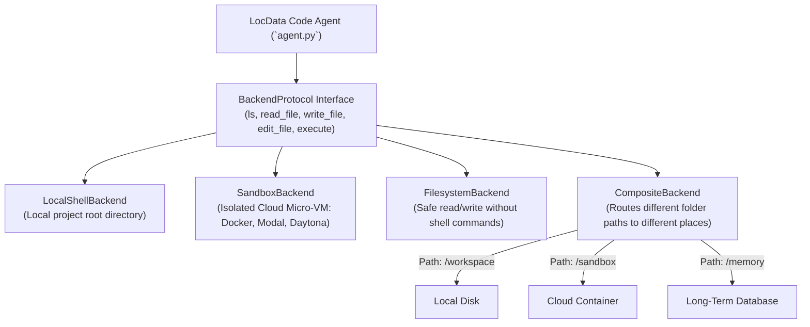
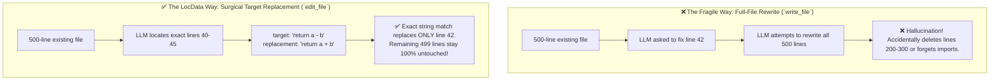

# 🛡️ Chapter 3: Backends, Sandboxing & Safety
### *How LocData Code Touches Files and Runs Commands Without Crashing Your Computer*

> 💡 **The Simple Analogy (Explain It Like I'm 12):**  
> Imagine you give a robot scissors and markers.  
> - If you tell it *"Go anywhere in the house,"* it might draw on your parent's bedroom wall or cut an electrical wire!  
> - Instead, you put the robot in a **dedicated craft room with a locked door** (the Workspace Sandbox).  
> - And before it uses superglue, it has to **raise its hand and ask you for permission** (Human-in-the-Loop Approval).

---

## 🗄️ 1. The `BackendProtocol` Abstraction

`loccode` never talks directly to raw operating system calls. Instead, it talks to a unified backend interface:



---

## ✂️ 2. Precision Editing (`edit_file`) vs. Full File Hallucination

Why does `loccode` use `edit_file` instead of rewriting entire files?



---

## 🚦 3. The 3-Tier Approval Safety Gatekeeper

Before any destructive command executes, `loccode` evaluates it through its safety engine:

```mermaid
flowchart TD
    Action["Tool Call Proposed:\n`execute('rm -rf test')` or `edit_file(...)`"] --> ModeCheck{"Current Approval Mode?"}

    ModeCheck -->|PROMPT| ShowDiff["Generate Colored Unified Diff / Command Preview"]
    ShowDiff --> AskUser{"Ask Engineer:\nApprove [Y/n]?"}
    AskUser -->|Approved| Exec["Execute Tool Safely"]
    AskUser -->|Rejected| Deny["Halt & Report to LLM: Action Denied"]

    ModeCheck -->|AUTO| AutoCheck{"Is action safe?\n(e.g., pytest, git status, read-only)"}
    AutoCheck -->|YES| Exec
    AutoCheck -->|NO (e.g. rm -rf, drop table, push --force)| ShowDiff

    ModeCheck -->|BYPASS| Exec
```
