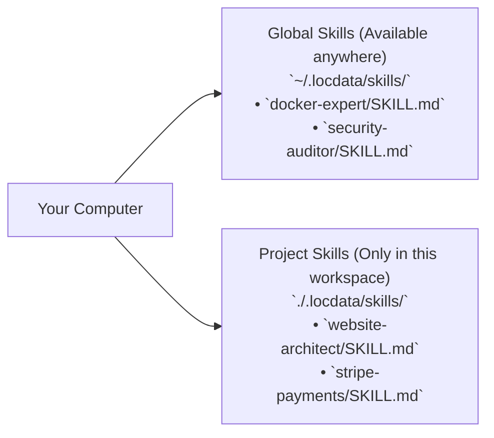

# 🧩 Chapter 5: Skills & Domain Knowledge
### *How LocData Code Learns New Capabilities Without Bloating Its System Prompt*

> 💡 **The Simple Analogy (Explain It Like I'm 12):**  
> Imagine a master chef.  
> If the chef had to repeat all 5,000 recipes in their head every morning, their brain would feel tired and slow before cooking even started!  
> Instead, the chef keeps a **binder of recipe cards** on the kitchen shelf (the Skills Folder).  
> When a customer orders a *"Chocolate Lava Cake"*, the chef takes out that **exact recipe card**, reads the steps, makes the cake, and puts the card back!

---

## 🛑 The Prompt-Bloat Problem vs. The Skills Solution

```mermaid
flowchart TD
    subgraph The_Bad_Way["❌ The Old Way: Bloated Mega-System Prompt"]
        P1["System Prompt: 20,000 tokens\n(Contains SQL rules, React rules, Docker rules, AWS rules, etc.)"]
        P1 --> Turn1["Turn 1: Pay 20,000 tokens ($0.10)"]
        Turn1 --> Turn2["Turn 2: Pay 20,000 tokens ($0.10)"]
        Turn2 --> Turn3["Turn 3: Pay 20,000 tokens ($0.10)"]
        Turn3 --> Result1["❌ High cost, slow response, and model gets confused ('prompt dilution')!"]
    end

    subgraph The_Skills_Way["✅ The LocData Way: On-Demand Skill Discovery"]
        S_Folder["Skills Folders (`.locdata/skills/`)"] --> Discover["Scan `SKILL.md` Frontmatter\n(Tiny footprint: < 100 tokens)"]
        Discover --> Match{"Does task need a specialized skill?"}
        Match -->|YES (e.g. Website requested)| Ingest["Ingest `website-architect` instructions only for this job"]
        Match -->|NO| Lean["Keep system prompt ultra-clean and fast"]
        Ingest --> Result2["✅ High quality, fast execution, low cost, and zero confusion!"]
    end
```

---

## 📄 The Anatomy of a `SKILL.md` File

Every skill in `loccode` consists of two parts:

```
┌─────────────────────────────────────────────────────────────┐
│ 1. YAML FRONTMATTER (The Index Card)                        │
│ ---                                                         │
│ name: website-architect                                     │
│ description: Expert frontend designer skill for generating  │
│              modern glassmorphism websites.                 │
│ ---                                                         │
├─────────────────────────────────────────────────────────────┤
│ 2. DETAILED INSTRUCTIONS (The Recipe)                       │
│ When building websites:                                     │
│ • Use semantic HTML5 landmarks (<header>, <nav>, <main>)    │
│ • Apply dark glassmorphism CSS (#0f172a, frosted cards)     │
│ • Implement responsive CSS Grid and fluid clamp() fonts     │
│ • Add interactive vanilla JavaScript (counters, tabs)       │
│ • Verify tag balancing and syntax before declaring done     │
└─────────────────────────────────────────────────────────────┘
```

---

## 📂 Where Skills Live in LocData Code



When you ask `loccode`:
```bash
loccode -x "Create a skill named 'api-tester' that instructs the agent on writing pytest tests"
```
It writes the `SKILL.md` file, and from that moment on, `loccode` knows how to follow those exact testing rules!
