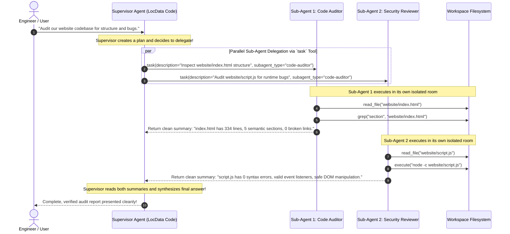
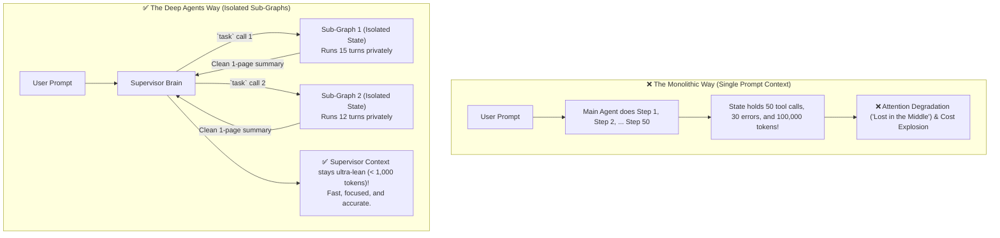

# 👥 Chapter 6: Sub-Agent Spawning & Orchestration
### *How LocData Code Multiplies Its Brain Power Without Getting Confused*

> 💡 **The Simple Analogy (Explain It Like I'm 12):**  
> Imagine you are the **Lead Detective** on a big mystery case.  
> You need to:  
> 1. Check the security cameras at the bank.  
> 2. Interview the shopkeeper down the street.  
> 3. Read the financial bank statements.  
> 
> If you do all three yourself one-by-one, it takes forever, and your notebook gets full of messy scribbles.  
> Instead, you dispatch **three junior detectives (Sub-Agents)**!  
> Each junior detective goes to their location, conducts the investigation in their own notebook (Isolated Context), and comes back to your desk with a **1-page summary report**.  
> You read their 3 clean reports and instantly solve the case!

---

## 🏢 The Supervisor-Worker Orchestration Pattern



---

## 🛡️ Context Isolation: Why Sub-Agents Keep the Main Brain Fast

The biggest secret to Deep Agents' subagent engine is **Context Isolation**:



---

## 🧪 Live Proof: Sub-Agent Execution in `loccode`

In our test environment (`/Users/sachinmishra/Desktop/loccode_test_env`), we executed:

```bash
loccode -x "Spin up a subagent using the task tool to inspect website/index.html and report its structure. Then summarize the result."
```

### What Happened Behind the Scenes:
1. **Tool Invocation:** The main agent invoked `task` with `subagent_type="general-purpose"`.
2. **Sub-Graph Compilation:** Deep Agents spun up a child graph with a fresh, isolated `AgentState`.
3. **Child Execution:** The child agent read `website/index.html` (334 lines), analyzed the DOM tree, counted heading tags, and checked accessibility landmarks.
4. **Result Hand-off:** The child agent returned a structured markdown summary back to the supervisor.
5. **Supervisor Synthesis:** The supervisor presented the final verified report without any of the child's raw intermediate steps cluttering the user interface.
