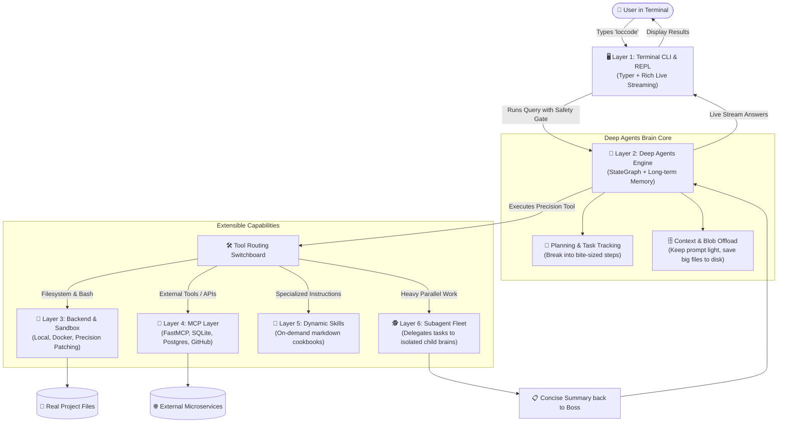

# 📚 LocCode Deep Agents — Complete Architecture & Engineering Manual

Welcome to the **LocCode Deep Agents** documentation suite! 

This guide breaks down every layer of how `loccode` works under the hood — from the fundamental **Deep Agents** orchestration engine to **Sandboxed Filesystem Backends**, **Model Context Protocol (MCP)**, **Skills On-Demand**, and **Multi-Agent Subagent Delegation**.

Every chapter is written with simple, relatable real-world analogies (designed so that even a 10–15 year old student can intuitively understand it) alongside precise visual diagrams and technical engineering details.

---

## 🗺️ Visual Architecture Map

Here is how the entire system connects together from the user's terminal keystroke down to file operations and subagent teams:

---

## 📖 Chapter Index & Learning Path

| Chapter | Title | The Real-World Analogy | What You'll Learn |
| :--- | :--- | :--- | :--- |
| **[Chapter 1](file:///Users/sachinmishra/Desktop/Langchain_Deep_Agents/documentation/01_ARCHITECTURE_OVERVIEW.md)** | **Architecture Overview** | 🏗️ *The 4-Story Smart Factory* | The 30,000-foot view of how the CLI, Deep Agent Loop, Backends, and Plugins collaborate seamlessly. |
| **[Chapter 2](file:///Users/sachinmishra/Desktop/Langchain_Deep_Agents/documentation/02_DEEP_AGENTS_CORE_ENGINE.md)** | **Deep Agents Core Engine** | 👨‍🍳 *The Master Chef vs Short-Order Cook* | Why traditional ReAct agents fail on big tasks, how Deep Agents plan, offload large text blobs, and maintain state. |
| **[Chapter 3](file:///Users/sachinmishra/Desktop/Langchain_Deep_Agents/documentation/03_BACKENDS_AND_SANDBOXING.md)** | **Backends & Sandboxing** | 🔒 *The Safety Gloves & Precision Scalpel* | How `BackendProtocol` protects files, why precision line-diff editing beats full file overwrites, and the 3-tier safety gatekeeper. |
| **[Chapter 4](file:///Users/sachinmishra/Desktop/Langchain_Deep_Agents/documentation/04_MCP_INTEGRATION_LAYER.md)** | **MCP Integration Layer** | 🔌 *The Universal USB-C Cable for AI* | How the Model Context Protocol connects any local or remote tool dynamically via standard JSON-RPC without hardcoding. |
| **[Chapter 5](file:///Users/sachinmishra/Desktop/Langchain_Deep_Agents/documentation/05_SKILLS_AND_KNOWLEDGE_SYSTEM.md)** | **Skills & Knowledge System** | 📚 *The Chef's Bookshelf of Secret Recipes* | How progressive disclosure prevents prompt bloat by loading instructions only when a specialized domain task is triggered. |
| **[Chapter 6](file:///Users/sachinmishra/Desktop/Langchain_Deep_Agents/documentation/06_SUBAGENT_ORCHESTRATION.md)** | **Subagent Orchestration** | 🕵️ *The Chief Detective and Field Agents* | How the supervisor agent spawns child subagents for massive parallel tasks while isolating context to keep the parent fast. |

---

## 🚀 Hands-On Verification & Live Proof

All concepts documented in this manual were validated end-to-end in live test environments:

1. **MCP Verification**: Verified using a custom Python `FastMCP` server (`my_mcp_server.py`) exposing financial ROI calculators and system monitoring tools.
2. **Skills Verification**: Demonstrated with `.locdata/skills/website-architect/SKILL.md` dynamically teaching `loccode` glassmorphism and modern UI design patterns.
3. **Subagent Delegation**: Verified in `/Users/sachinmishra/Desktop/loccode_test_env/` where `loccode` launched a `general-purpose` and `code-auditor` subagent using the built-in `task` tool, analyzing the full codebase in complete context isolation.

---

> [!TIP]
> **Recommended Reading Flow:** Start with **[01_ARCHITECTURE_OVERVIEW.md](file:///Users/sachinmishra/Desktop/Langchain_Deep_Agents/documentation/01_ARCHITECTURE_OVERVIEW.md)** to grasp the big picture, then proceed sequentially through chapters 2 through 6!
